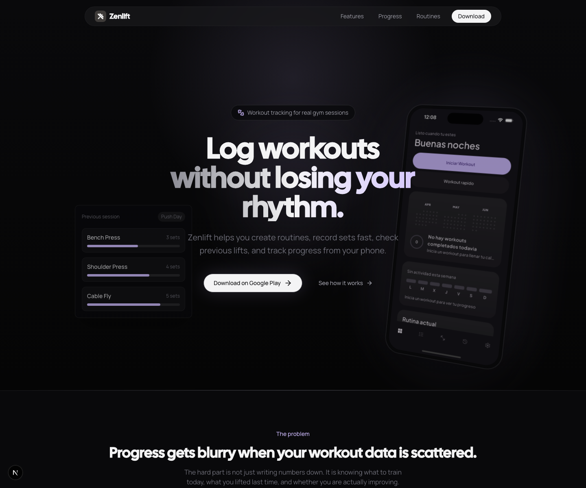
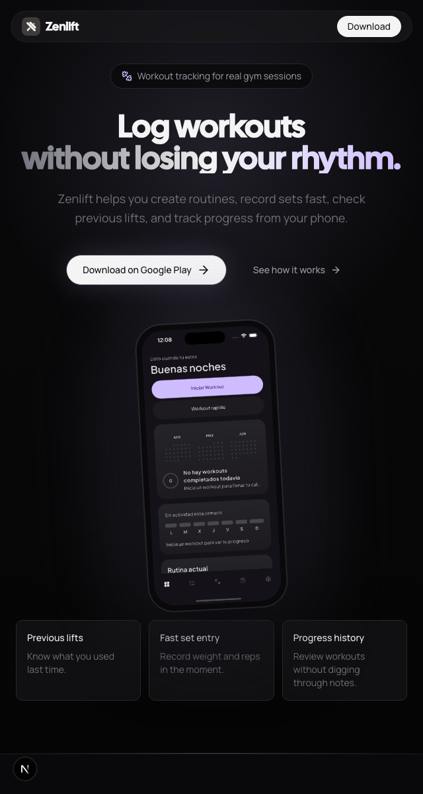
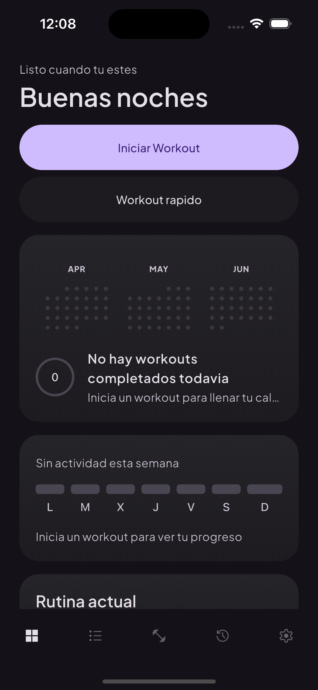

# Zenlift Landing Page

Zenlift Landing Page is a responsive product website for Zenlift, a Flutter workout tracking app built for real gym sessions. The site introduces the product, highlights the training workflow, and provides legal pages needed for a mobile app launch.

## Preview

### Desktop Web



### Mobile Web



### Product Screen



## About Zenlift

Zenlift helps gym users create routines, log sets quickly, review previous lifts, and track progress from their phone. This repository contains the marketing landing page for the app, with a focus on clear product messaging, responsive presentation, and launch-ready supporting pages.

## Highlights

- Built with the Next.js App Router and React Server Components where appropriate.
- Responsive dark interface with a focused visual system for a fitness product.
- Real app screenshot integration inside the landing-page hero.
- Dedicated privacy, support, and data-deletion routes for the current local-first mobile app, with an email path for earlier account-enabled versions.
- Developed with an OpenSpec workflow so product requirements, implementation changes, and specs stay traceable.

## Tech Stack

- **Framework:** Next.js App Router
- **Language:** TypeScript
- **UI:** React, shadcn/ui, Lucide React
- **Styling:** Tailwind CSS v4 with CSS-first theme variables
- **Motion:** Framer Motion and Lenis smooth scrolling
- **Website analytics integration:** None in this repository. Optional mobile diagnostics are described in the privacy policy.
- **Deployment:** Coolify with Nixpacks and an Nginx static image

## Development Process

This project was developed using OpenSpec. Canonical requirements live in `openspec/specs/`, while active and archived change artifacts live in `openspec/changes/`. This keeps product decisions, acceptance criteria, and implementation work connected across the project lifecycle.

## Getting Started

Use Node.js 24 LTS and pnpm 11.25 (the verified local toolchain). Install locked dependencies without package lifecycle scripts; this static export uses unoptimized images and builds without Sharp's install script:

```bash
pnpm install --frozen-lockfile --ignore-scripts
```

Start the development server:

```bash
pnpm dev
```

Run linting:

```bash
pnpm lint
```

ESLint uses the Next.js Core Web Vitals and TypeScript flat configurations. Run `pnpm typecheck` to check TypeScript separately. Production builds also check types; type errors are not ignored.

Create a production build:

```bash
pnpm build
```

## Project Structure

```text
app/                    Next.js routes and global styles
components/sections/    Landing-page sections
components/ui/          shadcn/ui components and shared UI primitives
components/providers/   Client-side providers
lib/                    Shared utilities
openspec/               Specs, proposals, and change workflow artifacts
public/                 Brand assets, app screenshots, and README previews
```

## Deployment

Production runs on the existing Coolify application for `zenlift.app`, using `main`, Nixpacks, Node.js 22 and pnpm 9.15.9. The build command is `pnpm build`; the static output directory is `/out`, served by Nginx. `pnpm-workspace.yaml` declares the root package for compatibility with the server's pnpm version. After pushing, verify that Coolify deployed the intended commit and that all public document routes return the current content.

## Public v1 support and privacy

- `/privacy/`: on-device workout storage, exercise-media requests, optional Firebase diagnostics, exports/deletion, and operator contact.
- `/support/`: English/Spanish email support, recovery advice, backups and local data actions.
- `/delete-account/`: the current local data deletion paths and a retained email request for earlier account-enabled versions.
- Operator: Victor David Sanchez García, Mexico, [dev@victorsanchez.mx](mailto:dev@victorsanchez.mx), centralized in `lib/operator.ts`.

The 2026-10-14 update follows the approved local-first mobile v1 scope and supersedes the June account/cloud-sync assumptions in archived designs. Keep the policy effective date, operator-specific retention/settings, applicable regional disclosures and legacy account request handling current. Do not invent a Firebase retention period or claim that local deletion erases previously transmitted diagnostics. Revalidate the live URLs after each deployment and include them in the mobile builds only once the public documents match the release.
